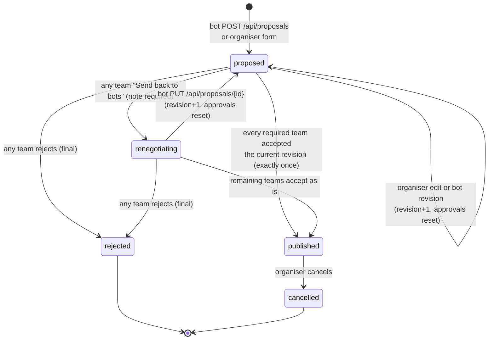
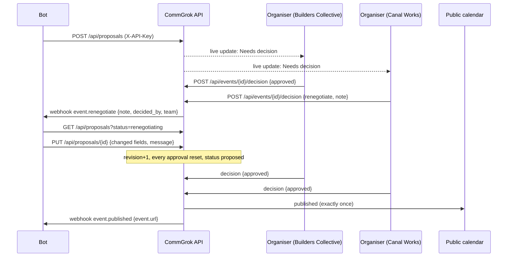
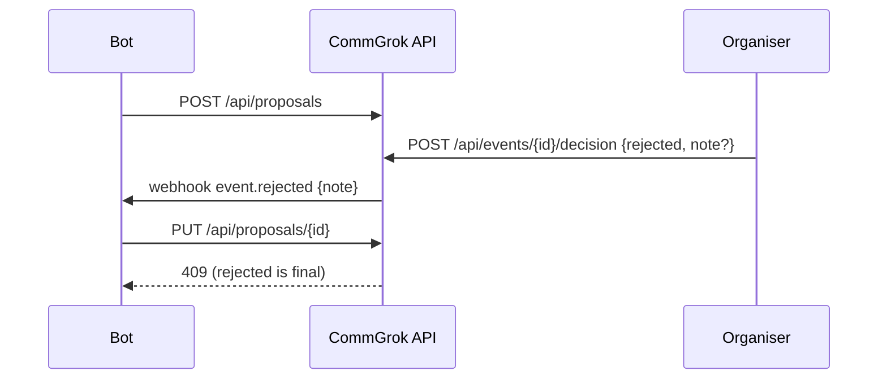

# CommGrok: technical handoff

<!-- docs:stamp -->_Last verified against commit `uncommitted` on 2026-10-22_<!-- /docs:stamp -->

The single source of truth for how CommGrok works. Bot-facing API details live in `docs/openapi.yaml`, changes in `docs/CHANGELOG.md`, and the rules every agent follows in `AGENTS.md`. `npm run docs:check` keeps this file honest: the marked blocks below are machine-checked against the code.

## Status at a glance

| Area | Status | Notes |
| --- | --- | --- |
| Public calendar, event pages, `.ics`, `/calendar.ics` | ✅ Working | Only published events are public; cancelled ones open with a banner |
| Guest RSVP + waitlist | ✅ Working | No account. Duplicate email returns the existing RSVP |
| Organiser accounts (email + password, invite code) | ✅ Working | Demo-grade: no email verification or password reset |
| Three decisions (accept / reject / send back to bots) | ✅ Working | Publish is idempotent (exactly once) |
| Bot API: propose, poll, revise, read | ✅ Working | `X-API-Key`; see `docs/openapi.yaml` |
| Webhooks (published / rejected / renegotiate) | ✅ Working | No retries or signing yet |
| Live updates | ✅ Local (SSE) / ⚠️ Supabase | Supabase broadcast is written but untested |
| Supabase backend | ⚠️ Untested live | Store reviewed for parity with local mode, `demo:reset` works in both modes, `npm run db:check` verifies a project. Not yet run against a real project |
| PWA / offline | ⚠️ Partial | Service worker only registers in production builds |
| Webhook signing, retries, rate limiting | ❌ Not built | |

## Roles

- **Public / guests**: browse `/`, open `/e/[slug]`, RSVP with name + email. They never log in.
- **Organisers**: one login type. Every account has a team (sign-up needs `ORGANISER_INVITE_CODE`). They decide in `/approvals` for their own team only. The team always comes from the session, never the request body (`lib/workflow.ts`).
- **Bots**: call the API with `X-API-Key: $PROPOSALS_API_KEY`. They never publish directly.

## Statuses, decisions and webhook types

Event statuses (`EventStatus` in `lib/types.ts`):
<!-- docs:event-statuses -->`proposed`, `renegotiating`, `rejected`, `published`, `cancelled`<!-- /docs:event-statuses -->

Organiser decisions (`Decision` in `lib/types.ts`):
<!-- docs:decisions -->`approved`, `rejected`, `renegotiate`<!-- /docs:decisions -->

Webhook types (`WebhookType` in `lib/types.ts`, emitted by `lib/workflow.ts`):
<!-- docs:webhook-types -->`event.published`, `event.rejected`, `event.renegotiate`<!-- /docs:webhook-types -->

Legacy data: the old status/decision `changes_requested` is read as `renegotiating` / `renegotiate` (normalised on load in `lib/store/local.ts`; the decision API still accepts it).

### State machine

Rules (implemented in `lib/workflow.ts`, see the contract comment at the top):

- Only open events (`proposed`, `renegotiating`) accept decisions or revisions; otherwise `409`.
- Reject and renegotiate win over pending accepts.
- Accepts only count for the current `revision`. An accept from an older revision shows as `stale` ("Revised — needs re-approval").
- `NEXT_PUBLIC_APPROVAL_MODE=all_teams` (default): every required team must accept. `any_organiser`: one accept publishes.
- Publishing is a conditional update from an open status, so simultaneous accepts publish, log and fire `event.published` exactly once.

### Sequence: send back, revise, publish

### Sequence: reject

## Bot integration

Source of truth: `docs/openapi.yaml` (tag **Bot**). In short:

| Call | What it does |
| --- | --- |
| `POST /api/proposals` | Propose an event. Returns the event JSON (`id`, `slug`, `status`, `review_url`, …) |
| `GET /api/proposals?status=renegotiating` | Poll for proposals sent back to the bots, each with `latest_note` |
| `PUT /api/proposals/{id}` | Send a revised version (changed fields + optional `message`) |
| `GET /api/events/{id}` | Read status, per-team decisions and notes, `latest_note`, RSVP counts |
| Webhook to `EVENTS_WEBHOOK_URL` | `{type, event, note, decided_by, team}` |

Example: `npm run demo:propose` (`scripts/demo-propose.mjs`) and `npm run demo:revise` (`scripts/demo-revise.mjs`) are working bot clients.

## Organisers and auth

- Code: `lib/session.ts` (signed cookie), `lib/password.ts` (scrypt), `lib/auth.ts` (page guards), `app/api/auth/`, `components/AuthForms.tsx`, `components/UserMenu.tsx`, and `proxy.ts` (early redirects and public 404s).
- Session: httpOnly, SameSite=Lax cookie `cb_session`, HMAC-SHA256 signed with `AUTH_SECRET`, 30 days.
- Demo accounts (password `demo1234`): `tom@commgrok.demo` (Builders Collective), `maya@commgrok.demo` (Canal Works). Restored by `npm run demo:reset`.
- Organiser UI: `app/approvals/page.tsx` (inbox tabs Decide / Bots / Live / Rejected), `app/approvals/[id]/page.tsx` and `components/ReviewActions.tsx` (Accept, Send back to bots, Reject).

## Data and storage

- Store interface: `lib/store/types.ts`. Local JSON store (default, zero setup): `lib/store/local.ts` writing `.data/db.json`. Supabase store: `lib/store/supabase.ts`.
- Tables: teams, users, events (with `revision`), event_required_teams, approvals (`decision`, `note`, `event_revision`), rsvps (unique per event + email), event_log. Schema: `supabase/migrations/20261022000000_init.sql`, then `supabase/migrations/20261022120000_renegotiate_reject.sql` and `supabase/migrations/20261022180000_supabase_parity.sql` (grants). Seed: `supabase/seed.sql`, mirrored for local mode by `lib/seed-data.ts`.
- Live updates: `app/api/live/route.ts` (SSE in local mode) and `lib/live-server.ts` (Supabase broadcast on channel `community-events-live`, event `change`).
- Mode switch: `isSupabaseMode()` in `lib/config.ts` is true when `NEXT_PUBLIC_SUPABASE_URL` and `SUPABASE_SERVICE_ROLE_KEY` are set; otherwise the local file store is used. Remove those vars and restart to go back to local mode.

### Supabase setup (summary; full guide in `README.md`)

1. Create a project (region West EU / London).
2. Run every file in `supabase/migrations/` in filename order, then `supabase/seed.sql` (or `npx supabase link` + `npx supabase db push`, then the seed).
3. Set `NEXT_PUBLIC_SUPABASE_URL`, `NEXT_PUBLIC_SUPABASE_ANON_KEY` (public, RLS-limited) and `SUPABASE_SERVICE_ROLE_KEY` (server-only) in `.env.local`.
4. `npm run db:check` (`scripts/db-check.mjs`): tables and row counts, anon can read published events but not proposals or RSVP emails, Realtime broadcast round trip.
5. `npm run build && npm start` (rebuild after changing `NEXT_PUBLIC_*`).

Access model: the server uses the service role for everything and enforces rules in `lib/workflow.ts`. RLS lets the anon key read published events and teams, insert RSVPs for published events, and read first names and counts through the `event_attendees_public` and `event_rsvp_counts` views. It can't read `rsvps`, `users`, `approvals` or `event_log`.

## Environment variables

<!-- docs:env -->
| Variable | Default | Required | Purpose |
| --- | --- | --- | --- |
| `PROPOSALS_API_KEY` | none | Yes, for the bot API | Shared secret bots send as `X-API-Key` |
| `AUTH_SECRET` | dev-only default | Yes in production | HMAC key for organiser session cookies |
| `ORGANISER_INVITE_CODE` | `commgrok` | No | Needed to create an organiser account |
| `NEXT_PUBLIC_APPROVAL_MODE` | `all_teams` | No | `all_teams` or `any_organiser` |
| `EVENTS_WEBHOOK_URL` | empty | No | Receives event.published / event.rejected / event.renegotiate |
| `PUBLISH_WEBHOOK_URL` | empty | No | Legacy alias, used only if `EVENTS_WEBHOOK_URL` is empty |
| `NEXT_PUBLIC_SITE_URL` | `http://localhost:3000` | No | Fallback base URL; the request host wins |
| `NEXT_PUBLIC_APP_NAME` | `CommGrok` | No | Branding |
| `NEXT_PUBLIC_CALENDAR_NAME` | `London Community Calendar` | No | Calendar title |
| `NEXT_PUBLIC_SUPABASE_URL` | empty | Supabase mode | Supabase project URL |
| `NEXT_PUBLIC_SUPABASE_ANON_KEY` | empty | Supabase mode | Public key (realtime) |
| `SUPABASE_SERVICE_ROLE_KEY` | empty | Supabase mode | Server-side key; never expose |
<!-- /docs:env -->

All of these are listed in `.env.example`.

## Demo scripts

| Command | What it does |
| --- | --- |
| `npm run demo:reset` | Restore seed events and demo accounts, in local or Supabase mode (`scripts/demo-reset.mjs`) |
| `npm run demo:propose` | Bot proposes "AI Builders Social × Expedite" (`scripts/demo-propose.mjs`) |
| `npm run demo:revise -- <id\|slug\|latest>` | Bot reads the latest organiser note and sends a revision (`scripts/demo-revise.mjs`) |
| `npm run smoke -- --base <url> --key <key>` | End-to-end smoke test (`scripts/smoke.mjs`) |
| `npm run db:check` | Verify a Supabase project: tables, RLS, Realtime (`scripts/db-check.mjs`) |
| `npm run docs:check` | Docs-vs-code checks (`scripts/docs-check.mjs`) |

## Keeping these docs accurate

- Rules: `AGENTS.md` ("Documentation contract"). Claude Code reads it via `CLAUDE.md`.
- `npm run docs:check`: routes vs `docs/openapi.yaml`, env vars vs `.env.example` and the table above, file paths cited in `docs/`, the status/decision/webhook enums, and a Redocly lint. Flags: `--staged` (pre-commit: also requires a `docs/CHANGELOG.md` entry when `app/api`, `lib` or `supabase` change), `--stamp`, `--skip-lint`.
- Pre-commit hook: `.githooks/pre-commit` (installed by `npm install` via the `prepare` script). Emergency bypass only: `git commit --no-verify`.
- CI: `../../.github/workflows/commgrok-ci.yml` (typecheck, build, docs:check, smoke test; on `main` it stamps this file), `../../.github/workflows/commgrok-docs-drift.yml` (PR comment when code changes without docs), and the optional `../../.github/workflows/commgrok-claude-docs.yml` (label a PR `update-docs`; needs the `ANTHROPIC_API_KEY` repo secret).

## Known issues

- ⚠️ A team that sent an event back can accept the same revision without the bot revising it, which publishes it. Intentional ("accept as is"), but worth knowing.
- ⚠️ Webhooks are fire-once with a 5s timeout, unsigned and not retried. Failures are recorded in the activity log.
- ⚠️ Cancelled events open on their page with a banner but are not listed on the calendar.
- ❌ No email verification, password reset or rate limiting on login.
